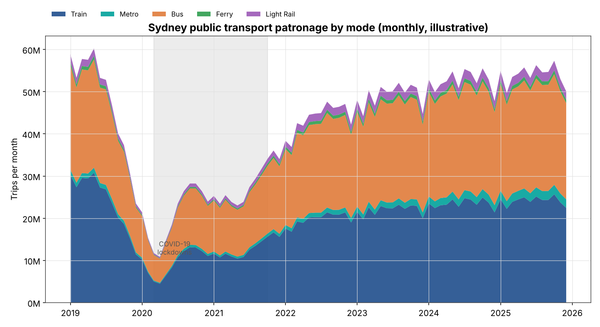
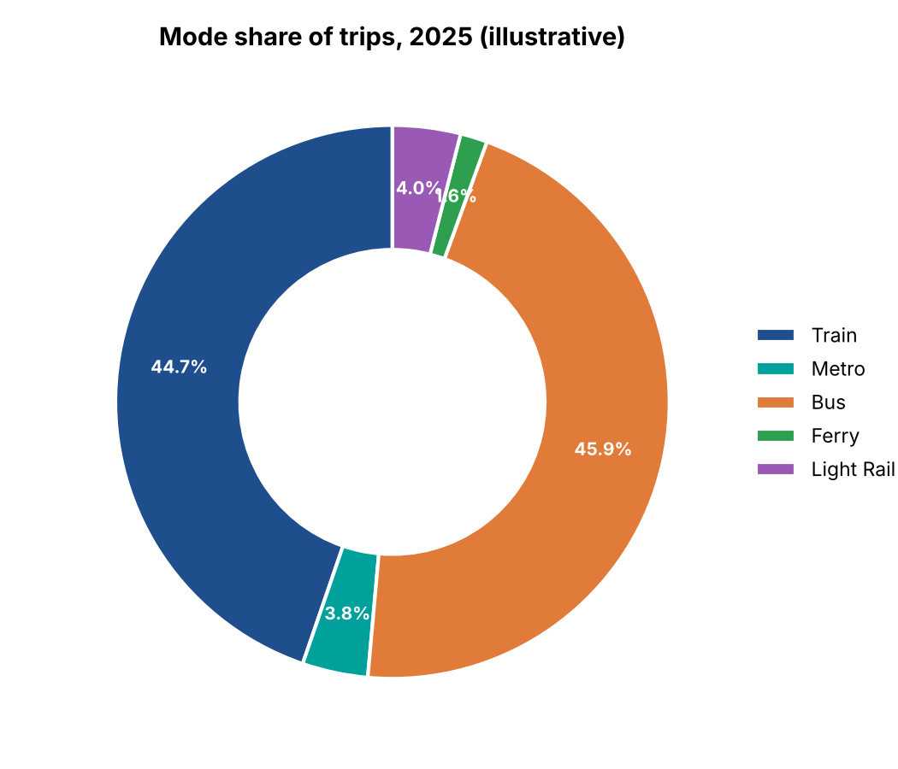
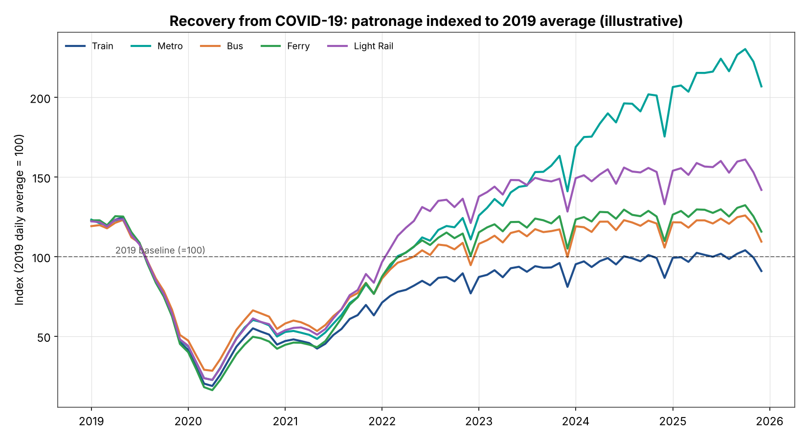
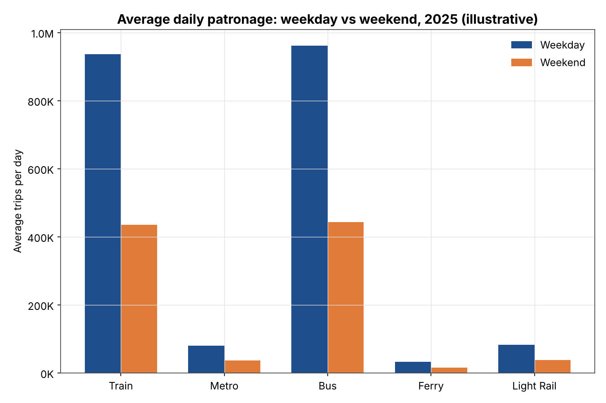

# Sydney Transport Analysis

A small, reproducible data-science project that explores patronage across Greater Sydney's public transport network: **Train, Metro, Bus, Ferry and Light Rail**, from 2019 to 2025.

> **Note: the bundled dataset is synthetic.** It is calibrated to publicly reported Transport for NSW (TfNSW) patterns so the pipeline runs out of the box, but it is **not real data**. See [Using real TfNSW data](#using-real-tfnsw-data) to swap it in.

## Charts

| | |
|---|---|
|  |  |
| Monthly patronage by mode, with the COVID-19 period shaded | Mode share of trips, 2025 |
|  |  |
| Each mode indexed to its 2019 daily average (=100) | Average daily trips, weekday vs weekend |

Patterns modelled in the synthetic data (consistent with TfNSW reporting):

- Sharp COVID-19 collapse in 2020, then an uneven recovery.
- Bus and ferry back near 2019 levels by 2024-25; light rail above 2019 thanks to new lines.
- Heavy rail (Train) still below its 2019 level, while Metro grows with network extensions.
- Strong weekday/weekend cycles and holiday dips.

## Project structure

```
sydney-transport-analysis/
├── analyze.py            # loads the CSV, writes the 4 charts
├── generate_data.py      # builds the synthetic dataset
├── data/
│   └── sydney_transport_patronage_synthetic.csv   # tidy: date, mode, trips
├── charts/               # generated PNGs
├── requirements.txt
├── LICENSE
└── README.md
```

## Quick start

```bash
git clone https://github.com/<your-username>/sydney-transport-analysis.git
cd sydney-transport-analysis

python3 -m venv .venv
source .venv/bin/activate        # Windows: .venv\Scripts\activate
pip install -r requirements.txt

python3 generate_data.py         # optional: regenerate the synthetic CSV
python3 analyze.py               # writes charts/*.png
```

## Using real TfNSW data

1. Create a free account on the [TfNSW Open Data Hub](https://opendata.transport.nsw.gov.au) (and an API key if you want programmatic access).
2. Download the **Opal Patronage** dataset (train, metro, bus, ferry and light rail, daily, from January 2020). Complete data refreshes every few days.
3. Reshape it into the tidy schema this project uses:

   ```csv
   date,mode,trips
   2024-01-01,Train,842193
   2024-01-01,Bus,701442
   ```

4. Save it as `data/sydney_transport_patronage_synthetic.csv` (or point `DATA_PATH` in `analyze.py` at your file) and re-run `python3 analyze.py`. The chart code only depends on those three columns.

Things to keep in mind with the real data:

- It starts in **January 2020**, so the 2019 baseline used in the recovery chart will need adjusting (for example, index to early 2020 or pull 2019 from the monthly all-modes dataset).
- TfNSW changed its trip-counting methodology in 2024, so avoid directly combining line, operator and mode totals across that change.
- Check the dataset's licence and terms before committing raw exports; `data/raw/` is git-ignored for that reason.

## Ideas to extend

- Join GTFS static feeds (stops, routes, shapes) for map-based views.
- Add on-time-running data for a reliability dimension.
- Break patronage down by key commercial centre.
- Add day-of-week heatmaps and rolling 7-day averages.

## License

MIT, see [LICENSE](LICENSE). Real TfNSW data is published under its own licence (Creative Commons Attribution) and remains subject to their terms.
